

  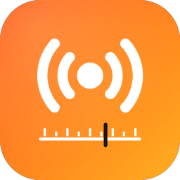 
  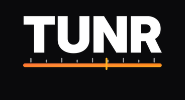

  <b>Alle radio van de wereld. Op elk scherm.</b> 
  iPhone · iPad · Mac · Apple TV · CarPlay · Android · Android TV · Android Auto · Web

  iOS 17+ · iPadOS 17+ · macOS 14+ · tvOS 17+ · Android 7+ (ook Google TV en Fire TV) · elke moderne browser

  
  
  

Tunr is een wereldwijde radio-app (werknaam): tienduizenden zenders uit meer dan 200 landen, met logo's, albumhoezen bij "nu speelt", een interactieve wereldkaart en favorieten die meegaan tussen je apparaten. De zenders komen uit de open community-database [Radio Browser](https://www.radio-browser.info); Tunr host zelf geen streams.

Wat er nieuw is per build: [CHANGELOG.md](CHANGELOG.md)

## Downloaden

| | |
|---|---|
| **Xcode-project** (iPhone, iPad, Mac, Apple TV, CarPlay — iOS 17+, iPadOS 17+, macOS 14+, tvOS 17+) | Alleen via het beheerdashboard **BeheerTunr** ([beheer.tunr.online](https://beheer.tunr.online) of de BeheerTunr-app) → tab **Downloads** (inloggen vereist) → zip uitpakken → `Tunr/Tunr.xcodeproj` openen |
| **Android-APK** (telefoon, tablet, Android TV, Android Auto — Android 7+) | Alleen via **BeheerTunr** → tab **Downloads** → `Tunr-1.0.0-build<N>.apk` |
| **Website** | [tunr.online](https://tunr.online) (geen webspeler: luisteren kan alleen in de apps) |

Buildpakketten staan niet op GitHub (geen releases, geen bestanden in de repo): de workflows *Apple* en *Android* zetten ze na een geslaagde build via FTPS op beheer.tunr.online.

## Screenshots

> Previews van de schermen (zelfde indeling als de apps).

| Kies je land | Ontdek | Bladeren | Kaart |
|:---:|:---:|:---:|:---:|
| 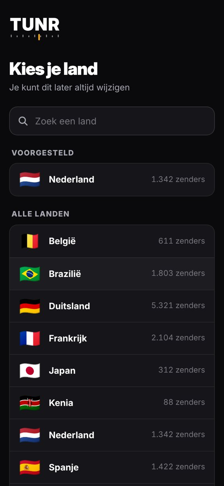 | 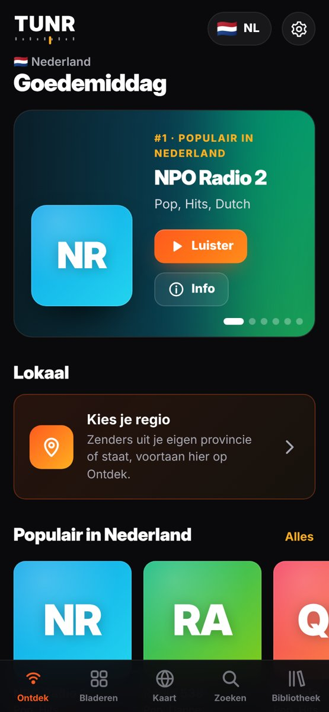 | 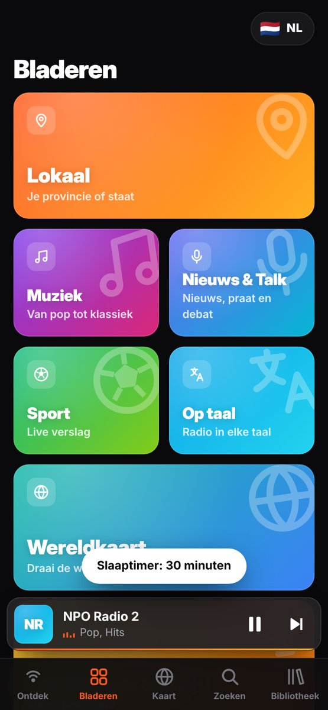 | 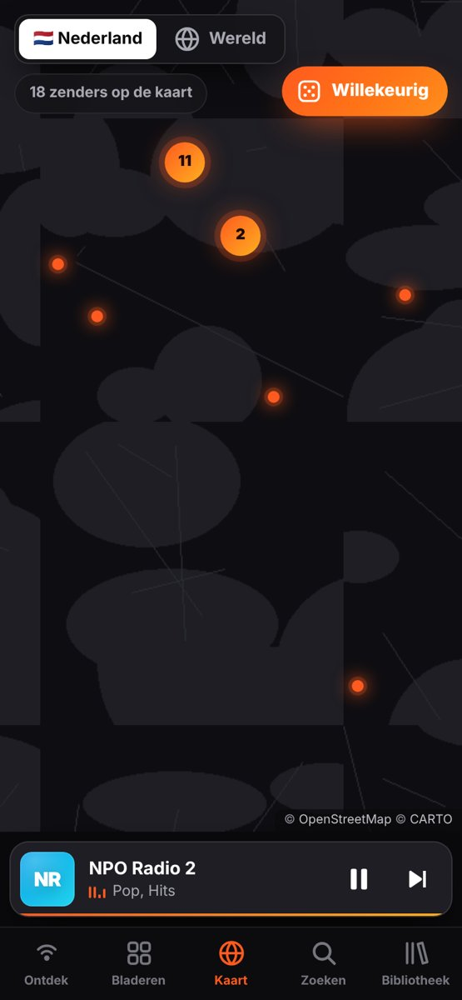 |
| **Speler** | **Zoeken** | **Bibliotheek** | |
| 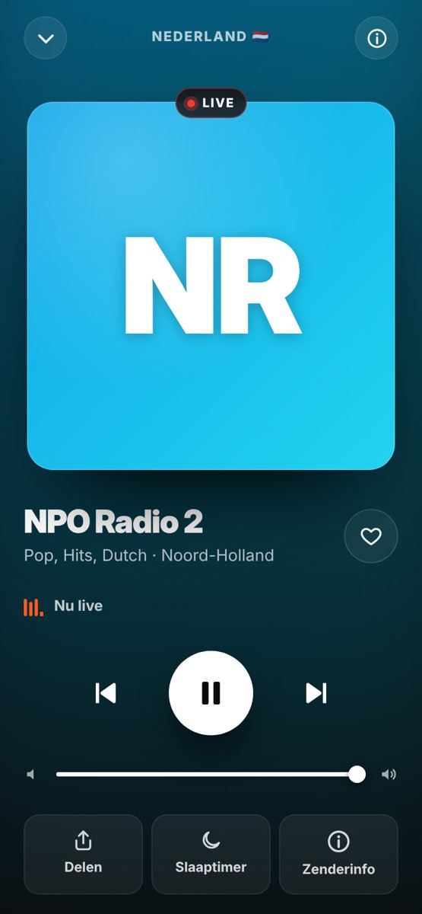 | 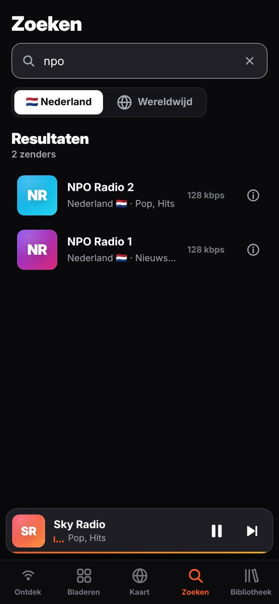 | 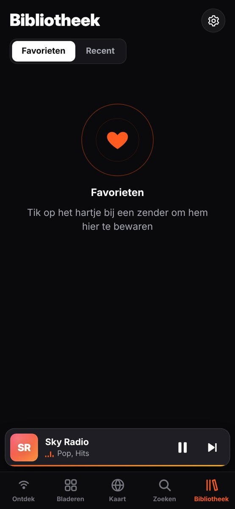 | |

**Groot scherm (iPad, Mac, web)**

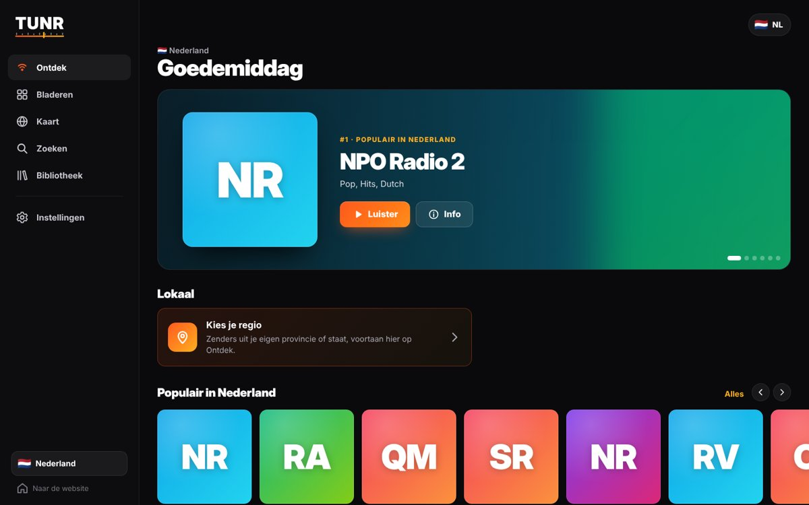

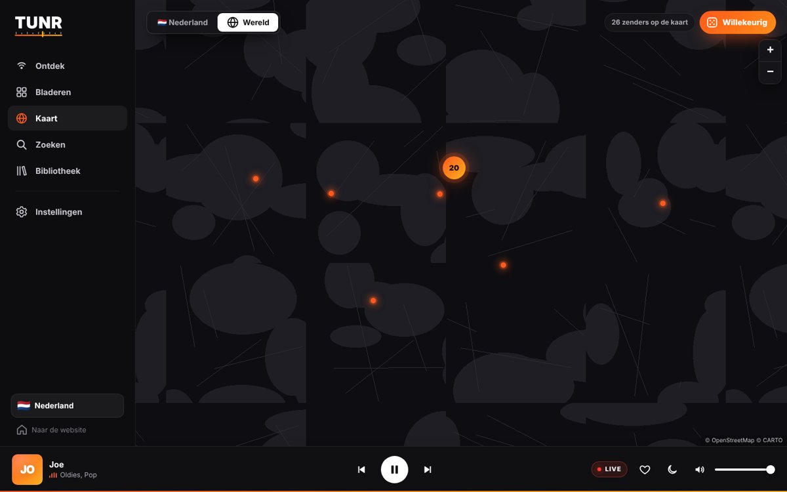

## Functies

**Start**
- Splash met frequentieschaal, een naald die "afstemt" en een eigen tune (uit te zetten)
- Landkeuze bij de eerste start: het land van je toestel als voorstel, vlaggen en het aantal zenders per land

**Luisteren**
- **Ontdek**: begroeting, top-6-carrousel, Verder luisteren, Lokaal (je eigen provincie/staat), Populair, Trending, Favorieten en genres
- **Bladeren**: Lokaal, Muziek, Nieuws & Talk, Sport, Op taal, Wereldkaart en Top 100 wereldwijd
- **Kaart**: donkere wereldkaart met een gloeiende stip per zender, clusters, een kaartje met zenders in de buurt en de knop **Willekeurig**
- **Zoeken** in je land of wereldwijd; **Bibliotheek** met Favorieten en Recent
- Zenderpagina met logo, genres, codec/bitrate, taal, website en vergelijkbare zenders

**Speler**
- LIVE-pil, equalizer, vorige/volgende zender, favoriet, delen, zenderinfo en slaaptimer
- **Nu speelt**: artiest, titel en albumhoes (iTunes) als de zender dat meestuurt
- Achtergrondaudio, vergrendelscherm/Bedieningspaneel en mediamelding; AirPlay op iPhone, iPad en Mac

**Per platform**
- **iPhone/iPad/Mac/Apple TV**: één Xcode-project met één multiplatform-target; favorieten via iCloud gedeeld; Mac met zijbalk en menu *Afspelen* (Spatie, ⌘←/⌘→, ⌘L)
- **CarPlay**: tabs Favorieten, Recent, Populair en Genres met Nu speelt (zodra Apple de CarPlay-entitlement toekent)
- **Android/Android TV/Android Auto**: één APK; tv-indeling met D-pad-focus; bladerboom voor Android Auto
- **Web**: website met uitleg, zenderpagina's per land en downloads; geen webspeler (offline om rechtenredenen)

## Repo

| Map | Inhoud |
|---|---|
| [`apple/`](apple) | SwiftUI-app, `Tunr.xcodeproj` (gemaakt uit `project.yml` met XcodeGen) — zie [`apple/README-dev.md`](apple/README-dev.md) |
| [`android/`](android) | Kotlin + Jetpack Compose + Media3 — zie [`android/README-dev.md`](android/README-dev.md) |
| [`website/`](website) | Website (NL/EN) |
| [`docs/`](docs) | [`SPEC.md`](docs/SPEC.md) (functionele spec en huisstijl), changelog, screenshots |
| [`tools/`](tools) | Tune, iconen en changelog |

Werkafspraken staan in [`CLAUDE.md`](CLAUDE.md).

## Bronnen

- Zendergegevens: [Radio Browser](https://www.radio-browser.info) (community, zonder sleutel)
- Albumhoezen: iTunes Search API
- Kaart: © OpenStreetMap-bijdragers, © CARTO (Android en web), Apple Maps (Apple)
